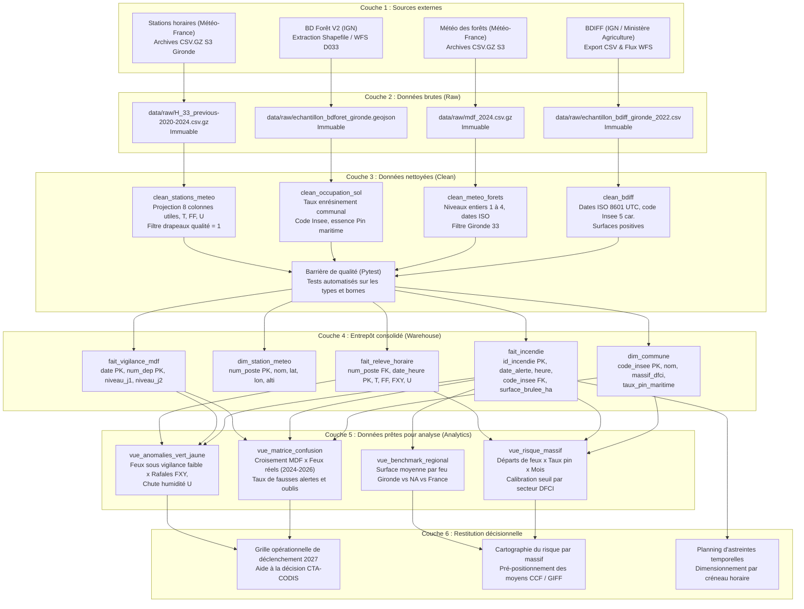

# Architecture technique du pipeline décisionnel - SDIS 33

* Auteur : Youssef DEKHAIL (Responsable pipeline et modèle)
* Binôme d'architecture : Ayoub AZACRI (Chef de projet)
* Date : 18 novembre 2026
* Référence projet : Section 10 de la spécification (`docs/specification.md`), ticket #32
* Objectif : Modéliser le flux complet de transformation des données depuis les sources Open Data brutes jusqu'aux indicateurs d'aide à la décision opérationnelle pour la saison feux 2027.

---

## 1. Schéma d'architecture des 6 couches

---

## 2. Description détaillée des 6 couches

### Couche 1 : Sources externes
* **Rôle :** Plateformes officielles de diffusion en Open Data des données publiques.
* **Composants :** Portail data.gouv.fr (BDIFF, Archives Météo des forêts, Données horaires de base Météo-France) et Géoplateforme IGN (BD Forêt V2).
* **Mode de collecte :** Téléchargements HTTP directs et requêtes d'extraction WFS pour les emprises géographiques ciblées.

### Couche 2 : Données brutes (Raw Data)
* **Rôle :** Zone d'atterrissage locale immuable. Les fichiers sont stockés sous leur forme native dans le répertoire `data/raw/`.
* **Règle de gestion :** Aucun fichier brut n'est altéré ni versionné sur Git (exclus via `.gitignore` pour préserver la légèreté du dépôt). Les données sont consultables hors-ligne pour garantir la reproductibilité totale sans dépendance réseau.

### Couche 3 : Données nettoyées (Clean Data)
* **Rôle :** Normalisation technique et application stricte du principe de minimisation.
* **Transformations :**
  1. *Standardisation temporelle :* Conversion de tous les horodatages en format ISO 8601 UTC (`YYYY-MM-DDTHH:MM:SSZ`).
  2. *Standardisation spatiale :* Formatage des codes Insee communaux sur 5 caractères avec zéro initial.
  3. *Projection colonne :* Réduction des 206 colonnes brutes des stations météo à 8 colonnes utiles (`NUM_POSTE`, `AAAAMMJJHH`, `T`, `FF`, `FXY`, `DD`, `U`, `RR1`).
  4. *Agrégation spatiale :* Extraction du pourcentage de couverture en pin maritime par commune à partir de la BD Forêt V2, sans conserver la géométrie polygonale lourde.
* **Barrière de qualité (Quality Gate) :** Validation automatisée par tests Pytest vérifiant la complétude (`id_incendie IS NOT NULL`), la validité physique (`surface >= 0`, `T <= 55 °C`) et les drapeaux de mesure (`Q = 1`).

### Couche 4 : Entrepôt de données consolidé (Warehouse)
* **Rôle :** Modèle dimensionnel en étoile sous moteur DuckDB, optimisé pour les requêtes analytiques rapides.
* **Schéma relationnel :**
  * *Tables de dimensions :* `dim_commune` (caractéristiques territoriales et taux d'enrésinement), `dim_station_meteo` (coordonnées et altitude des capteurs).
  * *Tables de faits :* `fait_incendie` (sinistres BDIFF validés), `fait_vigilance_mdf` (niveaux prévisionnels J+1/J+2), `fait_releve_horaire` (conditions atmosphériques physiques).
* **Clés de liaison :** Jointures relationnelles sur `code_insee`, `date` et couple (`NUM_POSTE`, `date_heure`).

### Couche 5 : Données prêtes pour l'analyse (Analytics / Datamart)
* **Rôle :** Vues SQL et tables dérivées directement exploitables pour répondre aux questions décisionnelles.
* **Vues spécialisées :**
  * `vue_matrice_confusion` : Décompte des vrais positifs, faux positifs, vrais négatifs et faux négatifs pour évaluer la pertinence de chaque couleur d'alerte.
  * `vue_risque_massif` : Taux de sinistralité par massif forestier DFCI et par mois pour guider la modulation géographique.
  * `vue_anomalies_vert_jaune` : Isolement des conditions de vent et d'hygrométrie lors des feux survenus sous indice faible.
  * `vue_benchmark_regional` : Surface moyenne par feu par département.

### Couche 6 : Restitution décisionnelle (Delivery)
* **Rôle :** Outils d'aide à la décision pour le commanditaire (SDIS 33).
* **Livrables :** Tableaux de bord de simulation du seuil optimal, cartographies des massifs prioritaires pour les rondes estivales, et calendrier hebdomadaire/horaire pour le dimensionnement des gardes postées.
